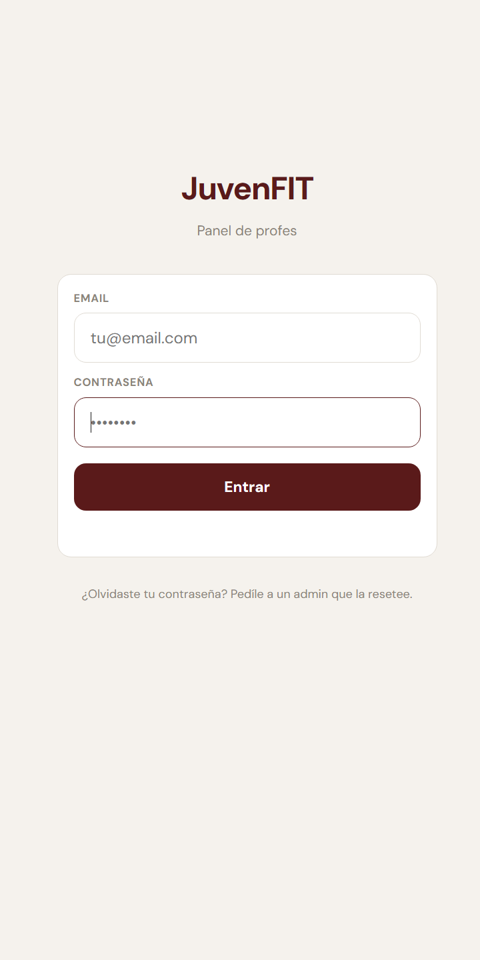

# JuvenFIT Coach

Coach-side web app for the JuvenFIT gym: manage the exercise library and athletes, build training routines, share them by QR code, and review the sessions athletes log in the companion tracker app.

**Live app:** https://jhk212.github.io/JuvenFit-Coach/



## Features

- **Coach login** with email and password (Supabase Auth); coaches can edit their display name and change their password from Settings.
- **Exercise library**
  - Categories: compound, isolation, core and mobility, plus a movement subcategory (horizontal/vertical push and pull, squat, hinge, lunge, ...).
  - Tracking mode per exercise: weight x reps, reps only, or time.
  - Muscle activation map (up to 5 muscles across 18 muscle groups) with auto-balancing to 100%.
  - Level, technical difficulty, fatigue and injury restrictions (lumbar, shoulder, knee, wrist, limited mobility, or custom), aliases, similar exercises and technical notes.
  - Combinable filters (level, difficulty, fatigue, restrictions, body zone) in both the library and the exercise picker.
- **Athletes** — profile with age, level, main goal, injuries/limitations, notes and optional starting loads. The athlete roster is shared between all coaches, with creator and last-editor tracking.
- **Routine editor**
  - Routine metadata: name, start date, weekly frequency, assigned weekdays, phase (adaptation, reconditioning, progression, performance) and coach notes.
  - Days made of blocks (mobility/warm-up, main, accessory, finisher, custom) containing exercises with sets, reps, rest and notes.
  - Supersets and tri-sets with a single shared rest, interval (work/rest x rounds) and EMOM group formats, and a drop set option on the last set (1-3 drops, -20% each).
  - Reusable core circuit presets (2-4 exercises, rounds, rest, time per exercise).
  - Muscle-balance pie charts per day and per routine.
  - Warning when exercises are missing sets or reps.
  - One active routine per athlete; creating a new one archives the previous. Archived routines can be reactivated or deleted.
- **Routine versions** — every content change is stored as a version; the coach can view changes, compare the original against the current routine, and restore an earlier version.
- **Import from ChatGPT** — the app builds a copyable prompt that includes the exercise library grouped by dominant body zone; the JSON returned by ChatGPT is pasted back, validated, mapped to library exercises and converted into a routine.
- **QR sharing** — generates a short token (valid 7 days) and a QR code, rendered client-side, that opens the athlete app with the routine ready to import.
- **Athlete activity** — sessions uploaded from the tracker: attendance this week vs. prescribed frequency, last 30 days and total; load/rep progress per exercise with sparklines; session list with set-level detail. Sessions deleted by the athlete are shown struck through and excluded from stats.

## How it works

- **Frontend** — a single `index.html` file with inline CSS and vanilla JavaScript. No build step and no framework. Screens (login, library, exercise editor, athletes, athlete detail, routine editor, day editor, settings) are `<div class="page">` sections toggled in place, with a bottom navigation bar. External scripts are loaded from jsDelivr: `@supabase/supabase-js` v2 and `qrcode-generator`.
- **Backend** — Supabase (Postgres + Auth + PostgREST). The coach app talks to the database directly through `supabase-js` using the public publishable/anon key; access control is enforced by Row Level Security policies:
  - Coaches read all athletes, routines and sessions (shared roster) but can only modify their own records; reads are restricted to accounts present in the `coaches` table.
  - Core presets are private to each coach.
  - A routine with a valid, unexpired `qr_token` is readable anonymously so the athlete app can import it.
- **Coach-athlete bridge** — the athlete app ([JuvenFit-Tracker](https://github.com/JHK212/JuvenFit-Tracker)) pairs a device by scanning the QR code and calling `claim_athlete_device` with a locally generated device secret (stored only as a SHA-256 hash). After pairing, the device pulls its active routine with `get_active_routine`, uploads completed sessions with `push_session` (idempotent upsert, 512 KB payload limit) and propagates deletions with `mark_session_deleted` (soft delete). All of these are `security definer` functions that validate the device secret; the underlying tables have no anonymous access.
- **Athlete accounts** — optionally, athletes sign in with an email one-time code (Supabase Auth). `claim_athlete_account` links the account to the paired athlete, `register_device_for_account` registers a new phone without a QR code, and `get_my_sessions` restores the full session history.
- **Offline** — the repository includes `sw.js`, a network-first service worker that caches `index.html` and falls back to the cache when offline. It is not registered by the current `index.html`, so the app requires a network connection to Supabase.

## Database

The SQL files are migrations to run in the Supabase SQL editor. Most are idempotent. They extend a base schema that is **not included** in this repository: the `coaches`, `athletes`, `routines` and `exercises` tables, their owner policies, and the `routine_versions` table with its trigger on `routines`.

Suggested order, based on dependencies between the files:

| # | File | What it does |
|---|------|--------------|
| 1 | `exercises-extra-fields.sql` | Adds `level`, `technical_difficulty`, `fatigue` and `restrictions` to `exercises`, with a GIN index on restrictions. |
| 2 | `mobility-seed.sql` | Inserts 12 mobility exercises. Notes how to widen the `category` check constraint if needed. |
| 3 | `core-presets-schema.sql` | Creates `core_presets` (reusable core circuits per coach) with owner-only RLS. |
| 4 | `core-presets-duration.sql` | Adds `duration_secs` (5-600 s) to `core_presets`. |
| 5 | `clasificacion-ejercicios.sql` | Data update: assigns level/difficulty/fatigue/restrictions to library exercises by name, recategorizes abdominal exercises as `core`, and merges duplicates (the delete step is commented out, to run manually after checks). |
| 6 | `qr-import-schema.sql` | Adds `qr_token` and `qr_expires_at` to `routines`; public read policy for routines with a valid token and for coach names. |
| 7 | `sync-schema.sql` | Coach-tracker bridge: `athlete_devices` and `sessions` tables, shared-roster read policies, and the `claim_athlete_device`, `push_session`, `get_active_routine` and `mark_session_deleted` functions. Requires `pgcrypto`. |
| 8 | `auth-accounts-schema.sql` | Athlete accounts: `athletes.user_id`, `free`/`extra` flags on `sessions`, `claim_athlete_account`, `register_device_for_account`, `get_my_sessions`, and restricts shared-roster reads to coaches. Also lists one-time Supabase dashboard steps (email OTP template, SMTP). |
| 9 | `plaza-flag.sql` | Adds the `plaza` flag to `sessions` (bodyweight substitution mode) and redefines `push_session` and `get_my_sessions` to include it. |
| 10 | `coaches-privacy.sql` | Restricts API reads of `coaches` to `id` and `name` (column privileges) and adds `get_my_coach_profile()` so each coach reads only their own email/role. Supersedes the public read in `qr-import-schema.sql`. |

`clasificacion-ejercicios.html` is a printable review sheet of the proposed exercise classification; `clasificacion-ejercicios.sql` applies the reviewed values.

## Tech stack

- HTML, CSS and vanilla JavaScript in a single file
- [Supabase](https://supabase.com/) — Postgres, Auth, Row Level Security, RPC functions (PL/pgSQL)
- `@supabase/supabase-js` v2 and `qrcode-generator` 1.4.4 via jsDelivr
- Google Fonts (DM Sans, JetBrains Mono)
- GitHub Pages for hosting

## Run locally

```bash
git clone https://github.com/JHK212/JuvenFit-Coach.git
cd JuvenFit-Coach
python -m http.server 8000
```

Then open http://localhost:8000.

The app connects to the Supabase project configured at the top of the `<script>` block in `index.html` (`SUPABASE_URL` and `SUPABASE_ANON`). To use your own backend, create a Supabase project, set up the base tables, apply the SQL files in the order above, create coach users in Supabase Auth with a matching row in `coaches`, and replace those two constants with your project URL and its publishable (anon) key. Never put a `service_role` key in the frontend.

## Project structure

```
.
├── index.html                    # The whole coach app (UI, styles, logic)
├── sw.js                         # Network-first service worker (not currently registered)
├── clasificacion-ejercicios.html # Printable exercise-classification review sheet
├── exercises-extra-fields.sql
├── mobility-seed.sql
├── core-presets-schema.sql
├── core-presets-duration.sql
├── clasificacion-ejercicios.sql
├── qr-import-schema.sql
├── sync-schema.sql
├── auth-accounts-schema.sql
└── plaza-flag.sql
```

## Notes

- The user interface and code comments are in Spanish.
- This app is the coach side of a two-app system. Athletes use [JuvenFit-Tracker](https://github.com/JHK212/JuvenFit-Tracker) to import routines via QR and log their sessions, which then appear in the athlete's activity view here. The muscle-group constants in `index.html` must stay in sync with the tracker.
